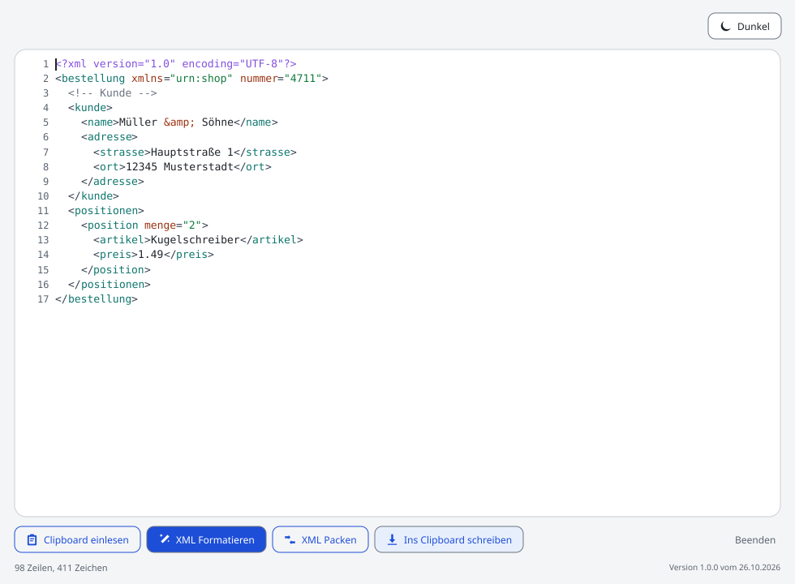
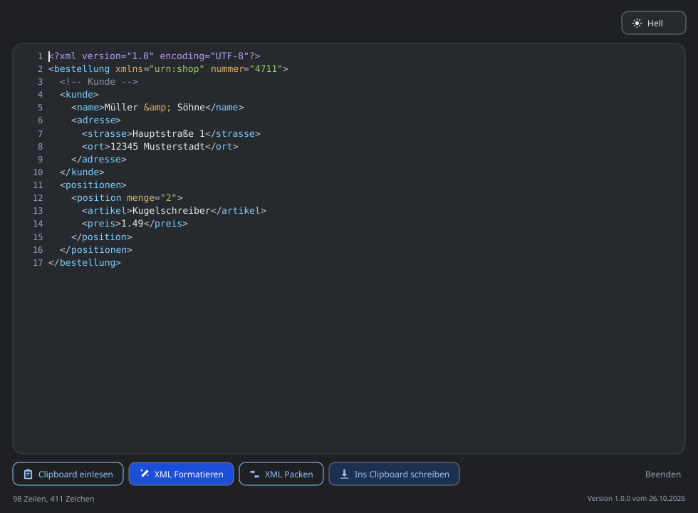

# XML Clipboard Formatter

Liest XML aus der Zwischenablage, macht es lesbar oder packt es auf möglichst
wenige Zeilen und schreibt es zurück. Für macOS und Windows, im Betrieb ohne
Installation, ohne Netzwerkzugriff, ohne Konto.



## Was es tut

| Knopf | Wirkung |
| --- | --- |
| **Clipboard einlesen** | Übernimmt den Text aus der Zwischenablage ins Textfeld |
| **XML Formatieren** | Ein Element je Zeile, vier Leerzeichen Einrückung |
| **XML Packen** | Entfernt den Leerraum zwischen Elementen, alles möglichst auf eine Zeile |
| **Ins Clipboard schreiben** | Schreibt den Inhalt des Textfelds zurück in die Zwischenablage |
| **Beenden** | Schliesst das Fenster |

Rechts oben wechselt das Programm zwischen hellem und dunklem Design. Das ist
die einzige Einstellung, und sie wird nicht gespeichert: Beim Start ist das
Fenster immer hell.

Der übliche Ablauf ist **Clipboard einlesen**, **XML Formatieren**, **Ins
Clipboard schreiben**. Wer eine Datei klein bekommen will, nimmt stattdessen
**XML Packen**. Formatieren und Packen ändern nur das Textfeld; erst der dritte
Schritt legt das Ergebnis in die Zwischenablage. So lässt sich das Ergebnis
vorher ansehen.

**Ins Clipboard schreiben** schneidet XML-Leerraum – Leerzeichen, Tabs und
Zeilenumbrüche – am Anfang und am Ende ab. Ein geschütztes Leerzeichen bleibt
stehen. Das Textfeld bleibt dabei unverändert; nur das, was in der
Zwischenablage landet, ist ohne diese Ränder.

## Was es einliest und was zurückgibt

Eingelesen wird XML als Text. Das Programm kennt keine DTD und kein Schema und
lädt nichts nach; es prüft die Form, nicht die Bedeutung. Aus:

```xml
<?xml version="1.0" encoding="UTF-8"?><bestellung xmlns="urn:shop" nummer="4711"><kunde><name>Müller &amp; Söhne</name></kunde><positionen><position menge="2"><artikel>Kugelschreiber</artikel><preis>1.49</preis></position></positionen></bestellung>
```

wird mit **XML Formatieren**:

```xml
<?xml version="1.0" encoding="UTF-8"?>
<bestellung xmlns="urn:shop" nummer="4711">
    <kunde>
        <name>Müller &amp; Söhne</name>
    </kunde>
    <positionen>
        <position menge="2">
            <artikel>Kugelschreiber</artikel>
            <preis>1.49</preis>
        </position>
    </positionen>
</bestellung>
```

und mit **XML Packen** wieder die eine Zeile von oben, mit genau einem
abschliessenden Zeilenumbruch.

Die kurze Form der Regeln:

- Vier Leerzeichen je Ebene.
- Ein Element je Zeile, wenn ein Element nur Elemente, Kommentare oder
  Verarbeitungsanweisungen enthält.
- Ein Element, das nur Text enthält, wird nicht zusätzlich umbrochen:
  `<name>Müller</name>`. Enthält der Text selbst Zeilenumbrüche, bleiben sie
  stehen.
- Gemischter Inhalt aus Text und Elementen bleibt Zeichen für Zeichen stehen.
  Zusätzliche Umbrüche würden dort den Inhalt verändern.
- Kommentare, CDATA-Abschnitte, Verarbeitungsanweisungen und die
  DOCTYPE-Deklaration bleiben erhalten.
- Attribute behalten Reihenfolge, Schreibweise, Anführungszeichen und Inhalt.
  `a='x &amp; y'` bleibt genau so stehen; Leerraum zwischen den Attributen wird
  auf ein Leerzeichen zusammengefasst.
- Leere Elemente werden im umbrochenen Baum als `<leer />` geschrieben. Ein
  ausdrücklich geschriebenes `<leer></leer>` bleibt ausdrücklich; in gemischtem
  Inhalt bleibt auch die Schreibweise eines leeren Elements, wie sie war.
- Ein BOM am Anfang fällt weg, Windows-Zeilenenden werden zu Unix-Zeilenenden,
  und die Ausgabe endet mit genau einem Zeilenumbruch.
- Named Entities werden nicht aufgelöst. `&amp;` bleibt `&amp;`, `&#228;`
  bleibt `&#228;`. Sie müssen lediglich die Form `&name;` oder `&#...;` haben;
  ob eine benannte Entity definiert ist, prüft das Programm nicht.

**Packen** entfernt den Leerraum zwischen Elementen. Leerraum in einem Element,
das nur Text enthält, bleibt stehen, weil er dort Bedeutung haben kann.
Enthält gemischter Inhalt, ein CDATA-Abschnitt oder ein Element mit nur Text
selbst Zeilenumbrüche, bleiben diese stehen; nur der Leerraum zwischen Elementen
fällt weg.

## Die Schranke in der Statuszeile

Formatieren, Packen und Schreiben sind gesperrt, solange der Text nicht als XML
erkannt wird. Erkannt wird am ersten Zeichen nach einem optionalen BOM und
Leerraum: Es muss `<` sein, und danach muss `!`, `?` oder ein Namensanfang
stehen (Buchstabe, `_` oder `:`).

| Text | Erkannt? | Warum |
| --- | --- | --- |
| `<bestellung/>` | ja | Name nach `<` |
| `  <?xml version="1.0"?>` | ja | `?` nach `<` |
| `<!-- Kommentar --><r/>` | ja | `!` nach `<` |
| `<` | nein | danach fehlt etwas |
| `</root>` | nein | `/` ist kein Namensanfang |
| `<3` | nein | Ziffer ist kein Namensanfang |
| `Einkaufsliste` | nein | beginnt nicht mit `<` |
| `{"a":1}` | nein | JSON, nicht XML |

Diese Prüfung ist eine Vermutung, keine Analyse, und soll auch eine sein: Sie
läuft nach jedem Tastendruck und darf den Text nicht sperren, an dem gerade
getippt wird. Der Formatter bleibt der Richter. Die Statuszeile sagt es
deutlich:

```
⚠ Der Text sieht nicht nach XML aus. Formatieren, Packen und Schreiben sind blockiert.
```

## Wenn etwas nicht stimmt

Kommt kein gültiges XML heraus, bleibt der Text unverändert stehen, und die
Meldung nennt Zeile und Spalte:

```
❌ Zeile 3, Spalte 5: Erwartet </a>, gefunden </r>. Der Text ist unverändert geblieben.
```

Es wird nichts repariert und nichts geraten. Ein Text, der als Datei
weitergeht, muss von hier aus nachvollziehbar bleiben. Typische Meldungen sind:

| Meldung | Bedeutung |
| --- | --- |
| `Es fehlt ein Wurzelelement.` | Der Text enthält kein Element |
| `Es darf nur ein Wurzelelement geben.` | Nach dem ersten Element beginnt ein zweites auf oberster Ebene |
| `Tag <r> wird nicht geschlossen.` | Ein öffnendes Tag hat kein Gegenstück |
| `Erwartet </a>, gefunden </r>.` | Die Tags sind falsch verschachtelt |
| `Text außerhalb des Wurzelelements ist nicht erlaubt.` | Vor oder nach dem Element steht sichtbarer Text |
| `Das Attribut 'a' steht mehrfach im selben Tag.` | Ein Attributname kommt doppelt vor |
| `Der Wert von 'a' muss in Anführungszeichen stehen.` | Attributwerte brauchen `"` oder `'` |
| `'&' muss als Entity geschrieben werden, zum Beispiel &amp;.` | Ein `&` ohne Entity-Form |
| `Die Entity wird nicht mit ';' geschlossen.` | Hinter `&name` fehlt das Semikolon |
| `Im Kommentar darf '--' nicht vorkommen.` | `--` ist in XML-Kommentaren verboten |
| `Zu tief verschachtelt (mehr als 10000 Ebenen).` | Die Tiefenbegrenzung greift |

Die Prüfung umfasst unter anderem: genau ein Wurzelelement, passende Anfangs-
und End-Tags, keine sichtbaren Texte ausserhalb der Wurzel, Attribute nur mit
Wert und Anführungszeichen, keine doppelten Attribute, gültige Entities,
geschlossene Kommentare, CDATA-Abschnitte und Verarbeitungsanweisungen, eine
DOCTYPE-Deklaration nur vor der Wurzel und mit demselben Namen wie die Wurzel,
CDATA nur innerhalb der Wurzel sowie eine XML-Deklaration nur am Anfang.

Die DOCTYPE-Deklaration wird nicht ausgewertet: Eine externe DTD wird nicht
geladen, und eigene Entities werden nicht aufgelöst. Die XML-Deklaration wird
ebenfalls nicht ausgewertet; der Text kommt als Unicode aus der
Zwischenablage, und `encoding="..."` ändert daran nichts.

## Warum kein Formatter von fremd

Go bringt mit `encoding/xml` einen XML-Leser mit. Der wäre kürzer, würde aber
genau die Schreibweise verlieren, die hier bleiben soll: Er liefert
Attributwerte ohne ihre Anführungszeichen, unterscheidet CDATA nicht mehr von
gewöhnlichem Text und löst Entity-Referenzen auf. Aus einem Dokument, das
unverändert weiterverwendet werden soll, würde so ein neu zusammengesetztes
Dokument.

Deshalb gibt es einen eigenen Lexer und einen eigenen Parser. Beide arbeiten
auf Zeichen, nicht auf Bytes, und kennen die Stücke, die XML ausmachen:
Start-Tags, End-Tags, Attribute, Text, Kommentare, CDATA,
Verarbeitungsanweisungen und DOCTYPE. Die Formatierung setzt daraus neuen
Leerraum, ändert aber kein sinntragendes Stück.

Nach jeder Ausgabe wird sie noch einmal gelesen und mit der Eingabe verglichen.
Stimmt die Zahl der Stücke nicht oder weicht eines ab, bricht der Vorgang ab,
statt ein Ergebnis zu liefern. Der Vergleich läuft bei jedem Formatieren und
Packen mit, nicht nur im Test. Leerraum zwischen Markup zählt dabei nicht — ihn
hinzuzufügen oder wegzulassen ist der Zweck des Formatierers. Sichtbarer Text,
Attribute, Kommentare, CDATA, Verarbeitungsanweisungen und DOCTYPE müssen
Zeichen für Zeichen gleich bleiben.

## Grenzen

- **Höchstens 10 000 Ebenen.** Tiefere Dokumente werden mit einer Meldung
  abgelehnt, statt den Aufrufstapel zu sprengen. Der Parser arbeitet mit einem
  Stapel, nicht mit Rekursion; die Grenze schützt die Ausgabe.
- **Lesbar formatieren wächst quadratisch mit der Tiefe.** Jede Ebene rückt
  ein, und jede Zeile trägt die Einrückung aller Ebenen darüber. Bei 10 000
  Ebenen ist die Ausgabe daher sehr gross, auch wenn die Grenze eingehalten
  wird. Packen bleibt linear; wer nur weiterverarbeiten will, nimmt Packen.
- **Mehr als 100 000 Zeichen werden nicht mehr eingefärbt.** Der Text bleibt
  vollständig bearbeitbar, nur die Syntaxfärbung endet oberhalb dieser Grenze.
  Formatieren und Packen lesen weiterhin alles.
- **Ein Dokument, ein Wurzelelement.** Mehrere Dokumente hintereinander sind
  kein gültiges XML und werden abgelehnt.
- **Keine Schema- oder DTD-Prüfung.** Ob ein Element an dieser Stelle erlaubt
  ist, weiss das Programm nicht. Es prüft nur, ob der Text wohlgeformt ist.
- **Nur Text.** Ein Bild in der Zwischenablage wird nicht in XML verwandelt.
  Das Textfeld bleibt, wie es war, und die Statuszeile meldet, dass die
  Zwischenablage leer ist oder keinen lesbaren Text enthält.
- **Kein Sitzungszustand.** Theme, Fensterposition und Inhalt werden nicht
  gespeichert. Beim nächsten Start ist das Fenster leer und hell.
- **Rückgängig endet beim Einlesen, Formatieren oder Packen.** Der Editor merkt
  sich bis zu 500 Schritte; ein neu eingelesener Text sowie jede Ausgabe von
  Formatieren oder Packen setzen den Verlauf zurück.

## Loslegen

**macOS**

Voraussetzungen: Go 1.24 oder neuer und die Xcode Command Line Tools.

```bash
xcode-select --install
git clone https://github.com/BENUTZERNAME/xmlClipboardFormatter.git
cd xmlClipboardFormatter
./start.sh
```

`BENUTZERNAME` steht für den GitHub-Namen des Repository-Inhabers.

`start.sh` baut das Programm beim ersten Start selbst und danach nur, wenn eine
Quelldatei neuer ist als die ausführbare Datei. Weitere Schalter:
`./start.sh -Neu` baut neu, `./start.sh -Pruefen` prüft nur die Umgebung und
baut nichts. Details in [docs/anleitung-macos.md](docs/anleitung-macos.md).

**Windows**

Voraussetzungen: Go 1.24 oder neuer und mingw-w64 (gcc) für cgo. Beides lässt
sich mit dem Installer von [go.dev](https://go.dev/dl/) und
[MSYS2](https://www.msys2.org/) einrichten; der Ordner `mingw64\bin` muss im
`PATH` liegen.

```bat
start.bat
```

Beim ersten Start wird `build\XMLClipboardFormatter.exe` gebaut. `start.bat
-Neu` baut neu, `start.bat -Pruefen` prüft nur die Umgebung. Details in
[docs/anleitung-windows.md](docs/anleitung-windows.md).

Zum Bauen von Hand:

```bash
go build -trimpath -o build/XMLClipboardFormatter .
```

Auf Windows heisst das Ziel `build\XMLClipboardFormatter.exe`. Ohne
`-ldflags` zeigt die Fusszeile die eingebaute Version und das Datum des Starts.
Die Startskripte setzen das Build-Datum. Version und Datum lassen sich auch von
Hand setzen:

```bash
go build -trimpath \
  -ldflags "-X main.version=1.0.0 -X main.versionDate=$(date '+%d.%m.%Y')" \
  -o build/XMLClipboardFormatter .
```



## Bedienung

Beim Start ist das Textfeld leer und hell. Oben rechts steht **Dunkel** mit
einem Mond; im dunklen Design steht dort **Hell** mit einer Sonne. Der Knopf
zeigt an, wohin er wechselt, nicht wo man gerade ist.

Links im Textfeld stehen Zeilennummern. Sie zählen **Bildschirmzeilen**: Eine
lange Zeile bricht weich um und bekommt für jeden sichtbaren Teil eine eigene
Nummer. Der Zähler in der Statuszeile nennt dieselbe Zahl, zum Beispiel
`14 Zeilen, 480 Zeichen`. Ist das Feld leer, steht dort `0 Zeilen, 0 Zeichen`;
die Nummerierung beginnt trotzdem bei 1, wie in einem Editor mit einer leeren
Zeile. Zeichen werden als Unicode-Zeichen gezählt, nicht als Bytes; ein
Zeilenumbruch zählt als ein Zeichen.

Steht keine Meldung an, zeigt die Statuszeile den Zähler. Erfolgsmeldungen
verschwinden nach vier Sekunden. Warnungen und Fehler bleiben stehen, bis der
Text geändert oder die nächste Aktion ausgelöst wird.

Im Textfeld funktionieren die üblichen Tastenkürzel des Systems: Ausschneiden,
Kopieren, Einfügen, Alles auswählen, Rückgängig und Wiederholen. `Tab` rückt
eine Auswahl ein; ohne Auswahl fügt es vier Leerzeichen an der Cursorposition
ein. `Shift+Tab` nimmt bis zu vier Leerzeichen am Zeilenanfang zurück. `Enter`
übernimmt die Einrückung der aktuellen Zeile. Ein Rechtsklick öffnet dasselbe
Menü für Ausschneiden, Kopieren, Einfügen, Alles auswählen, Rückgängig und
Wiederholen.

## Wie das Programm arbeitet

```
Zwischenablage
      |
      v
  xmlfmt.Lexer      zerlegt den Text in Stücke, meldet Fehler mit Zeile und Spalte
      |
      v
  xmlfmt.Parser     prüft die Struktur mit einem Stapel statt mit Rekursion
      |
      v
  Pretty/Compact    setzt Leerraum neu, ändert kein sinntragendes Stück
      |
      v
  Prüfung           liest die Ausgabe erneut und vergleicht sie mit der Eingabe
      |
      v
  Editor            zeigt das Ergebnis, Cursor bleibt an seiner Stelle
      |
      v
  Zwischenablage
```

`internal/xmlfmt` ist die Fachlogik und kennt weder Fyne noch Fenster.
`internal/editing` enthält den Textpuffer mit Cursor, Auswahl und Undo.
`internal/xmlhighlight` zerlegt Text für die Syntaxfärbung. Die Oberfläche in
`main.go`, `ui.go`, `editor.go`, `button.go`, `theme.go` und `icons.go` setzt
daraus das Fenster zusammen.

## Quellen und Tests

```
main.go                         Programmstart, Fenster, Version
ui.go                           Aufbau, Aktionen, Statuszeile, Theme
editor.go                       eigener XML-Editor mit Zeilennummern
button.go                       die fünf Knopfstile
theme.go                        helle und dunkle Farben, Masse
icons.go                        Symbole als SVG
ui_test.go                      Oberflächentests mit dem Fyne-Testtreiber
internal/xmlfmt/
  lexer.go                      XML in Stücke, Fehler mit Zeile und Spalte
  parser.go                     Strukturprüfung, Tiefenbegrenzung
  format.go                     Pretty, Compact, Prüfung der Ausgabe
  xml.go                        LooksLikeXML, Fehlertyp, Normalisierung
internal/editing/
  model.go                      Textpuffer, Cursor, Auswahl, Undo
internal/xmlhighlight/
  highlight.go                  Syntaxfärbung ohne Regex
```

Die Tests laufen ohne echtes Fenster:

```bash
go test ./...
go vet ./...
```

Die Anwendung selbst braucht zur Laufzeit kein Netzwerk. Der erste Bau lädt
die Fyne-Module in den Go-Modulcache; danach reicht der Cache.

## Wenn etwas nicht passt

| Beobachtung | Ursache |
| --- | --- |
| Formatieren, Packen und Schreiben sind grau | Der Text sieht nicht nach XML aus. Die Statuszeile nennt den ersten Eindruck |
| `❌ Zeile X, Spalte Y: ...` | Der Text enthält einen Fehler. Die Stelle ist genannt, der Text ist unverändert |
| `Fehler: Go wurde nicht gefunden` | Go fehlt oder ist nicht im `PATH`. Nach der Installation ein neues Terminal öffnen oder `XMLFORMATTER_GO` auf den Pfad zu `go` setzen |
| `Fehler: Go ... ist zu alt` | Go 1.24 oder neuer installieren |
| `Fehler: Kein C-Compiler gefunden` | macOS: `xcode-select --install`. Windows: mingw-w64 installieren und `mingw64\bin` in den `PATH` aufnehmen |
| `start.sh: Permission denied` | `chmod +x start.sh start.command` |
| `start.bat` schliesst sich sofort | In `cmd` starten, damit die Meldung sichtbar bleibt: `start.bat` |
| `ld: warning: ignoring duplicate libraries: '-lobjc'` | Harmlose Warnung des macOS-Linkers beim Fyne-Bau |
| Fenster öffnet, ist aber nicht zu sehen | Das Programm im Dock oder in der Taskleiste anklicken |
| Die Zwischenablage ist leer | Es gibt keinen Text zum Einlesen. Bilder und Dateien werden nicht übernommen |
| Sehr hoher Speicherverbrauch beim Formatieren | Sehr tief verschachteltes XML. Siehe Grenzen; Packen ist linear |

## Stand

Version 1.0.0, erste Fassung. Der Text beschreibt den Stand dieses Commits.
Was sich geändert hat, steht in [docs/aenderungen.md](docs/aenderungen.md).
